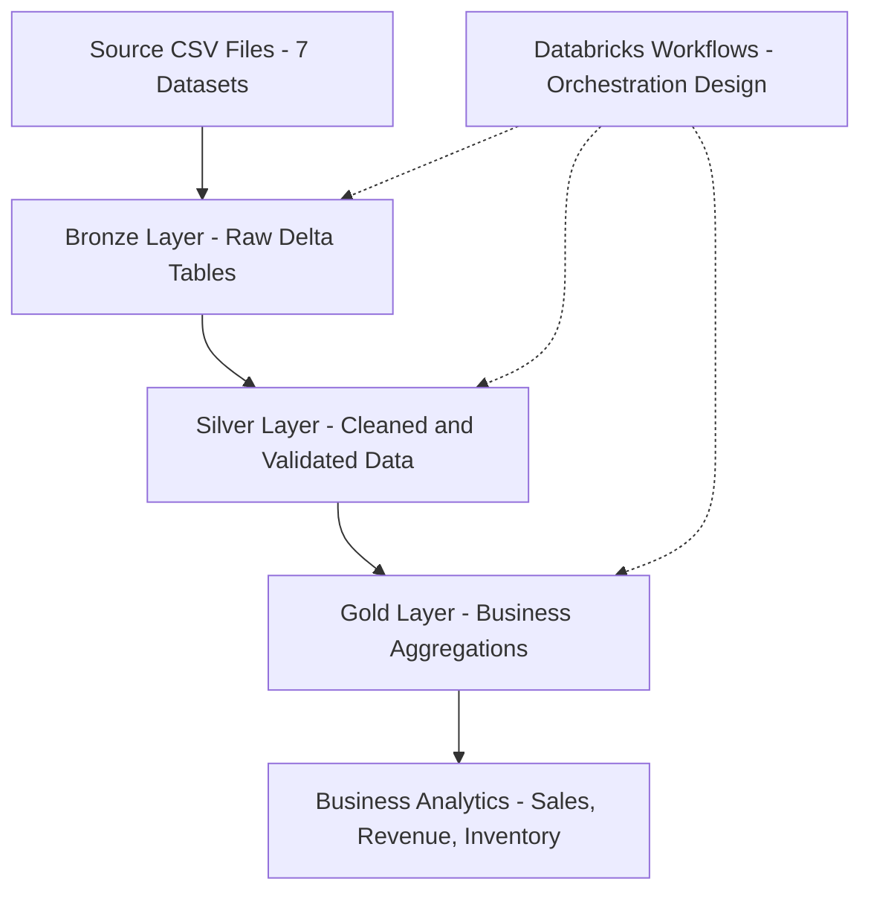

# QuickKart — End-to-End Data Engineering Project

## Project Overview

QuickKart is a fictional quick-commerce platform inspired by businesses that deliver groceries and everyday essentials to customers.

This project demonstrates how raw operational data can be ingested, cleaned, transformed, and converted into meaningful business insights using Databricks and PySpark.

The project follows the **Medallion Architecture**, consisting of Bronze, Silver, and Gold layers.

## Technology Stack

- **Platform:** Databricks Free Edition
- **Processing:** Apache Spark, PySpark
- **Storage:** Delta Lake
- **Architecture:** Medallion Architecture
- **Language:** Python
- **Data Format:** CSV and Delta

## Architecture




## Source Datasets

The project uses seven synthetic datasets:

| Dataset | Records |
|---|---:|
| Customers | 500 |
| Products | 100 |
| Stores | 10 |
| Orders | 5,000 |
| Order Items | 12,631 |
| Inventory | 1,000 |
| Deliveries | 4,246 |
| **Total** | **23,487** |

## Implementation

### 1. Bronze Layer
- Read source CSV files.
- Ingest raw data into Databricks.
- Store the datasets as Delta tables.

### 2. Silver Layer
- Handle missing and duplicate records.
- Standardize text values.
- Validate data and relationships.
- Apply business rules and data cleaning.

### 3. Gold Layer
Created analytical datasets for:
- Sales by category.
- Revenue by store.
- Order status summary.
- Top-selling products.
- Top three products by category.
- Low-stock inventory.
- Store inventory summary.

## Advanced Data Engineering Concepts

The project also explores:

- Delta Lake MERGE (UPSERT).
- Incremental data loading using `left_anti` joins.


## Business Insights

Some of the metrics explored include:

- Delivery success rate: 84.92%.
- Store revenue comparisons.
- Best-selling products.
- Category-level revenue.
- Inventory levels and low-stock products.

These results are based on synthetic project data and are not actual business performance figures.

## Project Structure

```text
QuickKart/
├── notebooks/
├── documentation/
└── README.md
```

## Project Objective

The objective is to demonstrate practical data engineering skills, including data ingestion, transformation, Delta Lake operations, incremental processing, and analytical data preparation using Databricks and PySpark.

## Future Enhancements

- Integrate cloud object storage such as AWS S3.
- Implement production-grade incremental pipelines.
- Add automated data quality reporting.
- Configure and execute scheduled Databricks Workflows.
- Connect Gold tables to a BI dashboard.

---

